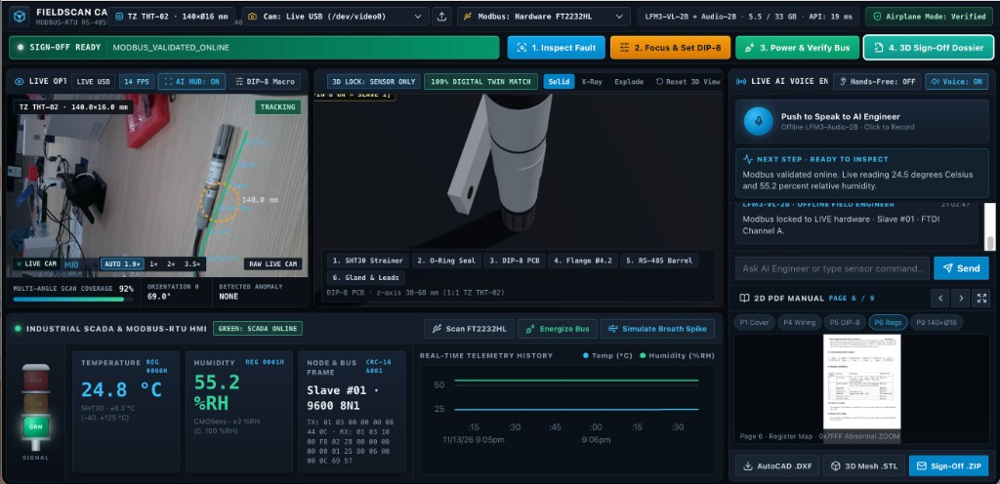

# FieldScan CAD · Digital Twin (TZ THT-02)

<p align="center">
  
</p>

**Offline industrial FieldScan copilot** for the Tzone **TZ THT-02** RS-485 temperature & humidity sensor.

USB UVC vision · 2D PDF manual · Liquid AI LFM2.5 (VL + Audio) · Three.js 60 FPS parametric CAD · AutoCAD DXF/STL escalation · Modbus-RTU SCADA.

Validated target platforms: **Apple Silicon** and **Qualcomm Dragonwing IQ-9075** (Ubuntu 24.04 aarch64).

## Highlights

- **100% offline runtime** after one-time asset staging (`offline_guard` air-gap)
- **Live CV** cylinder tracking, DIP-8 optical decode, hand/tool occlusion freeze
- **Modbus-RTU** master with CRC-16, 3-miss debounce, Andon coil driver
- **LFM2.5** multimodal diagnose + Piper English TTS
- **CAD export**: AutoCAD R2010 DXF, binary STL, offline store-and-forward EML/ZIP
- **SCADA UI**: 3-zone industrial slate & cyan shell (zero purple)

## Quick start

```bash
uv sync --extra dev
bash scripts/download_assets.sh   # online once: GGUFs, Piper, llama.cpp, vendor JS
bash scripts/start_all.sh         # :8091 VL · :8092 Audio · :8088 FastAPI
```

Open `http://127.0.0.1:8088`

## Tests

```bash
uv run pytest -v
```

Twelve offline glue gates (`T01`–`T12`) must pass with network disabled.

## Repository layout

| Path | Role |
|------|------|
| `src/fieldscan/` | Custom glue (guard, PDF, vision, Modbus, LFM, CAD, repair, server) |
| `static/` | SCADA UI (`index.html`, `styles.css`, `app.js` + vendored Three.js/uPlot) |
| `knowledge/THT02_spec.json` | Canonical geometry, DIP-8, Modbus map |
| `scripts/` | Asset staging + 3-daemon launcher |
| `tests/` | Offline pytest suite |

> Large model weights (`models/*.gguf`, Piper ONNX) and `bin/llama-b*` are **not** committed. Run `scripts/download_assets.sh` locally.

## License

MIT — hackathon-friendly open source. See [LICENSE](LICENSE).

## Topics

`fieldscan` · `digital-twin` · `modbus` · `opencv` · `threejs` · `fastapi` · `offline-ai` · `liquid-ai` · `qualcomm` · `iq-9075` · `industrial-iot` · `hackathon`
